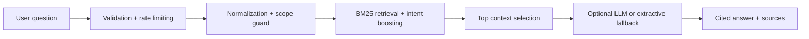

<div align="center">
  
</div>

# CareerSage AI

**Career intelligence. Grounded in evidence.** A retrieval-first RAG API for career questions, resume skill-gap analysis, and role recommendations.

[Complete technical guide](README-original.md) · [Architecture](docs/ARCHITECTURE.md)

## Slide 1 — Cover

CareerSage AI is a zero-dependency, production-ready RAG career intelligence API. It answers career questions from a curated knowledge base, provides explainable citations, analyzes resume skill gaps, and refuses out-of-scope questions.

## Slide 2 — Problem

| Traditional career chatbots | CareerSage AI |
|---|---|
| Confident but unverifiable answers | Answers grounded in retrieved documents |
| Generic advice | Role-specific career guidance |
| Shallow resume analysis | Skill-gap analysis against target roles |
| Off-topic questions confuse the model | Scope guard refuses unrelated queries |

## Slide 3 — Solution

CareerSage uses a retrieval-first design:

```text
Career question → Normalize → Scope guard → Retrieve → Cited answer
```

Every answer includes source citations such as `[data-analyst:roadmap]`.

## Slide 4 — Capabilities

| Capability | What it delivers |
|---|---|
| Career Q&A | Grounded answers with inline citations |
| Resume skill gaps | Compares resume skills with a target role |
| Role recommendations | Suggests suitable roles from resume skills |
| Hallucination control | Refuses out-of-scope questions |
| Query intelligence | Handles aliases and common typos |
| Safe fallback | Extractive answers work without an LLM key |

## Slide 5 — Architecture



The core API uses only the Python standard library. Optional LLM generation supports Gemini or Claude.

## Slide 6 — Run locally

```bash
git clone https://github.com/AnyalstRushi/careersage-ai.git
cd careersage-ai
python -m app.server
```

Open `http://localhost:8000`.

| Method | Route | Purpose |
|---|---|---|
| GET | `/` | Web UI |
| GET | `/health` | Health and LLM status |
| POST | `/api/ask` | Career question |
| POST | `/api/gap` | Resume skill gaps |
| POST | `/api/recommend` | Role recommendations |

## Slide 7 — Validate and deploy

```bash
python -m unittest discover -v
python eval/run_eval.py
```

```bash
docker build -t careersage-ai .
docker run -p 8000:8000 --env-file .env careersage-ai
```

## Slide 8 — Roadmap

- [ ] Hybrid BM25 + vector retrieval
- [ ] Cross-encoder reranking
- [ ] Live job-posting ingestion
- [ ] Resume PDF parsing
- [ ] RAGAS faithfulness evaluation in CI
- [ ] Marathi and Hindi query support

## Documentation

- [Complete original guide](README-original.md)
- [Architecture documentation](docs/ARCHITECTURE.md)

## License

MIT. See [LICENSE](LICENSE).
