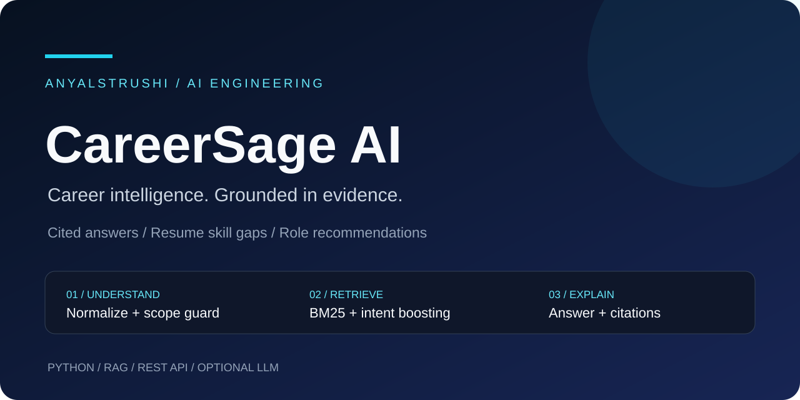
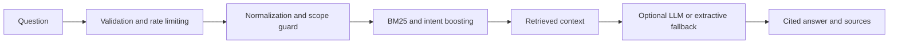

<p align="center"></p>

<h1 align="center">CareerSage AI</h1>
<p align="center">A retrieval-first career intelligence API with cited answers, resume skill-gap analysis, and role recommendations.</p>
<p align="center"><a href="#project-at-a-glance">Overview</a> · <a href="#system-design">Architecture</a> · <a href="#run-locally">Run locally</a> · <a href="README-original.md">Complete technical guide</a></p>

## Project at a glance

| The problem | The approach |
|---|---|
| Career advice can be difficult to verify. | Retrieve from a curated knowledge base and include document citations. |
| Resume skills do not always match a target role. | Compare resume skills against role requirements. |
| General questions can distract a career assistant. | Apply a scope guard before generating an answer. |

## What you can explore

| Career Q&A | Resume analysis | Role recommendations |
|---|---|---|
| Answers grounded in retrieved context. | Skill gaps for a selected target role. | Roles suggested from resume skills. |

## System design



The core API uses the Python standard library. Optional LLM generation supports Gemini or Claude; extractive fallback works without an LLM key.

## Run locally

```bash
git clone https://github.com/AnyalstRushi/careersage-ai.git
cd careersage-ai
python -m app.server
```

Open `http://localhost:8000`. No public hosted demo is linked here.

## API surface

| Method | Route | Purpose |
|---|---|---|
| GET | `/` | Web UI |
| GET | `/health` | Service health and LLM status |
| GET | `/api/roles` | Available roles and skills |
| POST | `/api/ask` | Career questions |
| POST | `/api/gap` | Resume skill gaps |
| POST | `/api/recommend` | Role recommendations |

## Validate the project

```bash
python -m unittest discover -v
python eval/run_eval.py
```

These are the documented test commands, not a claim that tests were executed during this visual update.

## Documentation and next steps

- [Complete original guide](README-original.md): setup, example requests, deployment, security, project structure, and roadmap.
- [Architecture documentation](docs/ARCHITECTURE.md).
- Planned work includes hybrid retrieval, reranking, live job ingestion, and resume PDF parsing. These are roadmap items, not implemented-feature claims.

## License

MIT. See [LICENSE](LICENSE).
