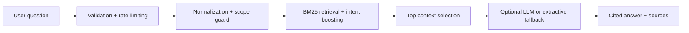

<div align="center">

# 🎯 CareerSage AI

### Career intelligence. Grounded in evidence.

**A retrieval-first RAG API for career questions, resume skill-gap analysis, and role recommendations.**


[Complete technical guide](README-original.md) · [Architecture](docs/ARCHITECTURE.md)

---

## 🎬 SLIDE 1 — The Problem

| Traditional career chatbots | CareerSage AI |
|---|---|
| Confident but unverifiable answers | Answers grounded in retrieved documents |
| Generic advice | Role-specific career guidance |
| Resume analysis is shallow | Skill-gap analysis against target roles |
| Off-topic questions confuse the model | Scope guard refuses unrelated queries |

---

## 💡 SLIDE 2 — The Solution

CareerSage uses a **retrieval-first design**: it understands the question, retrieves relevant context, and generates an answer only from that context.

```text
Career question → Normalize → Scope guard → Retrieve → Cited answer
```

Every answer includes source citations such as `[data-analyst:roadmap]`.

---

## 🧠 SLIDE 3 — Core Capabilities

| Capability | What it delivers |
|---|---|
| **Career Q&A** | Grounded answers with inline citations |
| **Resume skill gaps** | Compares resume skills with a target role |
| **Role recommendations** | Suggests suitable roles from resume skills |
| **Hallucination control** | Refuses out-of-scope questions |
| **Query intelligence** | Handles aliases and common typos |
| **Safe fallback** | Extractive answers work without an LLM key |

---

## ⚙️ SLIDE 4 — How It Works



The core API uses only the Python standard library. Optional LLM generation supports Gemini or Claude.

---

## 🧪 SLIDE 5 — Try It Locally

```bash
git clone https://github.com/AnyalstRushi/careersage-ai.git
cd careersage-ai
python -m app.server
```

Open: `http://localhost:8000`

| Method | Route | Purpose |
|---|---|---|
| GET | `/` | Web UI |
| GET | `/health` | Health and LLM status |
| POST | `/api/ask` | Career question |
| POST | `/api/gap` | Resume skill gaps |
| POST | `/api/recommend` | Role recommendations |

---

## 🚀 SLIDE 6 — Validate & Deploy

```bash
python -m unittest discover -v
python eval/run_eval.py
```

Docker deployment:

```bash
docker build -t careersage-ai .
docker run -p 8000:8000 --env-file .env careersage-ai
```

The repository includes Docker and Render deployment configuration.

---

## 🗺️ SLIDE 7 — Roadmap

- [ ] Hybrid BM25 + vector retrieval
- [ ] Cross-encoder reranking
- [ ] Live job-posting ingestion
- [ ] Resume PDF parsing
- [ ] RAGAS faithfulness evaluation in CI
- [ ] Marathi and Hindi query support

---

<div align="center">

### ⚡ Career intelligence, grounded in evidence ⚡

</div>
