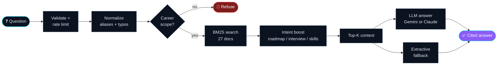

<div align="center">



<br>

[](https://github.com/AnyalstRushi/careersage-ai/actions/workflows/ci.yml)


**[⚡ Quick start](#-quick-start)** &nbsp;·&nbsp; **[🎬 See it work](#-see-it-work)** &nbsp;·&nbsp; **[🧩 Architecture](#-architecture)** &nbsp;·&nbsp; **[🔌 API](#-api)** &nbsp;·&nbsp; **[📑 Project deck](CareerSage_AI_Final.pdf)**

</div>

<br>

> **Most AI career tools sound confident and can't show their work.**
> CareerSage AI answers only from a curated knowledge base, cites every claim with a checkable `[doc-id]`, and refuses what it can't ground. No invented skills, no made-up courses.

<br>

## 🎯 Why it's different

| | Typical chat AI | **CareerSage AI** |
|---|---|---|
| Source of truth | Model memory | **27 curated documents** (9 roles × 3 document types) |
| Citations | None, or invented | **Every answer ends with `[doc-id]`** |
| Off-topic question | Answers anyway | **Refused, never guessed** |
| Typos like `machin learnin` | Hit or miss | **Understood as *machine learning*** |
| Runs without an API key | No | **Yes, via cited extractive fallback** |
| Runtime dependencies | Many | **0 (Python standard library only)** |

<br>

## 📊 Measured, not claimed

<div align="center">

<table>
<tr>
<td align="center" width="25%"><h2>23 / 23</h2><sub>automated tests<br>passing</sub></td>
<td align="center" width="25%"><h2>100%</h2><sub>hit@1 on a<br>35-question golden set</sub></td>
<td align="center" width="25%"><h2>100%</h2><sub>out-of-scope<br>refusal</sub></td>
<td align="center" width="25%"><h2>0</h2><sub>third-party<br>dependencies</sub></td>
</tr>
</table>

</div>

Tests run with `python -m unittest discover -v` and the golden-set evaluation with `python eval/run_eval.py`. Both run on every push through GitHub Actions.

<br>

## 🎬 See it work

Real inputs and real outputs. Every example below is asserted in the automated test suite, so the numbers are reproducible.

### 1 · Ask a career question

```text
❯ What skills are required for a data analyst role?
```

The answer contains the role summary and the exact skill list from the knowledge base, and ends with the `[doc-id]` citations you can verify.

### 2 · Typos and intent, handled

| You type | CareerSage understands | Result |
|---|---|---|
| `machin learnin` | typo-fixed to **machine learning** | `[ml-engineer:roadmap]` ranked first |
| `how to become ...` | intent = **roadmap**, not summary | roadmap document boosted to the top |

### 3 · Resume skill-gap analyzer

```text
Target role : Backend Developer
Resume      : Python, SQL, Docker, Git, FastAPI, testing

   75% match
   Missing  : rest apis, system design
   + roadmap and interview focus for the gap
```

### 4 · Role matcher

```text
Resume : html css javascript react typescript git

   #1  Frontend Developer      (ranked by % of required skills matched)
```

<br>

## 🧩 Architecture



**Design principle:** retrieve first, then answer. The language model, when enabled, can only rephrase what retrieval found. With no API key the system still works through the extractive fallback and the answer is always cited.

<br>

## ✨ Features

| | Capability | Details |
|---|---|---|
| 🔎 | **Grounded Q&A** | BM25 retrieval with intent boosting over a curated knowledge base |
| ✅ | **Verifiable citations** | Inline `[doc-id]` references on every answer |
| 📊 | **Skill-gap analyzer** | Resume vs. target role: % match, missing skills, roadmap and interview focus |
| 🎯 | **Role matcher** | Ranks roles by the % of required skills your resume covers |
| 🧠 | **Alias and typo tolerance** | `ML → machine learning`, `k8s → kubernetes`, typo fixing via `difflib` |
| 🚫 | **Scope guard** | No role or skill term in the question means a refusal, not a guess |
| 🔌 | **Optional LLM mode** | Gemini or Anthropic Claude, with automatic extractive fallback |
| 🛡️ | **Hardened by default** | 100 KB body cap, input validation, per-IP rate limit, non-root Docker |

<br>

## ⚡ Quick start

```bash
git clone https://github.com/AnyalstRushi/careersage-ai.git
cd careersage-ai
python -m app.server
```

Open **http://localhost:8000** and you get the UI and the API in one process.

> [!TIP]
> Nothing to install. The core runs on the Python standard library alone.

<details>
<summary><b>🔑 Enable LLM answers (optional)</b></summary>

<br>

Create a `.env` file:

```env
GEMINI_API_KEY=your_gemini_api_key
LLM_MODEL=gemini-2.5-flash
RATE_LIMIT=60
PORT=8000
```

Restart the server. `GET /health` should now return:

```json
{"status":"ok","docs":27,"llm":true}
```

Never commit `.env` or put API keys in source code.

</details>

<br>

## 🔌 API

| Method | Endpoint | What it does |
|:---:|---|---|
| `GET` | `/` | Web UI |
| `GET` | `/health` | Status, document count, LLM on/off |
| `GET` | `/api/roles` | Supported roles and their skills |
| `POST` | `/api/ask` | Ask a career question, get a cited answer |
| `POST` | `/api/gap` | Resume vs. target role skill-gap analysis |
| `POST` | `/api/recommend` | Recommend roles from resume text |

<details>
<summary><b>📮 Example requests</b></summary>

<br>

```bash
# Ask a career question
curl -X POST http://localhost:8000/api/ask \
  -H "Content-Type: application/json" \
  -d '{"question":"What skills are required for a data analyst role?"}'

# Resume skill gap
curl -X POST http://localhost:8000/api/gap \
  -H "Content-Type: application/json" \
  -d '{"resume":"Python SQL Excel Power BI dashboards","role":"data-analyst"}'

# Role recommendation
curl -X POST http://localhost:8000/api/recommend \
  -H "Content-Type: application/json" \
  -d '{"resume":"Python SQL Azure ETL data pipelines"}'
```

</details>

<br>

## 🚢 From laptop to public URL

| Step | Command / action |
|:---:|---|
| **1 · Run** | `python -m app.server` |
| **2 · Containerize** | `docker build -t careersage-ai .` then `docker run -p 8000:8000 --env-file .env careersage-ai` (non-root user, health check at `/health`) |
| **3 · Ship** | GitHub Actions runs tests and eval, then Render deploys from `render.yaml`. Set `GEMINI_API_KEY` as an environment variable. |

<br>

## 🛡️ Security

- API keys come from environment variables only, and `.env` is git-ignored
- Request bodies are capped at 100 KB and inputs are validated
- Per-IP rate limiting protects the API
- Docker image runs as a non-root user and bakes in no secrets

<br>

## 📑 Project deck

<div align="center">


**[⬇️ Download the full deck (PDF)](CareerSage_AI_Final.pdf)**

</div>

<br>

<details>
<summary><b>🗂️ Project structure</b></summary>

<br>

```text
careersage-ai/
├── app/
│   ├── server.py          # HTTP server, validation, rate limiting
│   ├── rag.py             # normalize, scope guard, BM25, intent boost
│   ├── llm.py             # optional Gemini / Claude generation
│   ├── data.py            # curated knowledge base
│   └── static/index.html  # web UI
├── tests/                 # unit and API tests
├── eval/                  # golden set and evaluation runner
├── docs/ARCHITECTURE.md
├── .github/workflows/ci.yml
├── Dockerfile
├── render.yaml
└── LICENSE
```

</details>

<br>

## 🗺️ Roadmap

| 🔍 Retrieval upgrades | 🚀 Product upgrades |
|---|---|
| ☐ Dense embeddings with Qdrant or pgvector | ☐ Marathi and Hindi queries |
| ☐ Hybrid BM25 + vector search | ☐ User accounts and conversation memory |
| ☐ Cross-encoder reranker | ☐ Resume PDF parsing |
| ☐ Live job-posting ingestion | ☐ RAGAS faithfulness scoring in CI |

<br>

---

<div align="center">

**Built by [@AnyalstRushi](https://github.com/AnyalstRushi)** &nbsp;·&nbsp; MIT License

If CareerSage AI is useful or inspiring, a ⭐ on the repo means a lot.

</div>
