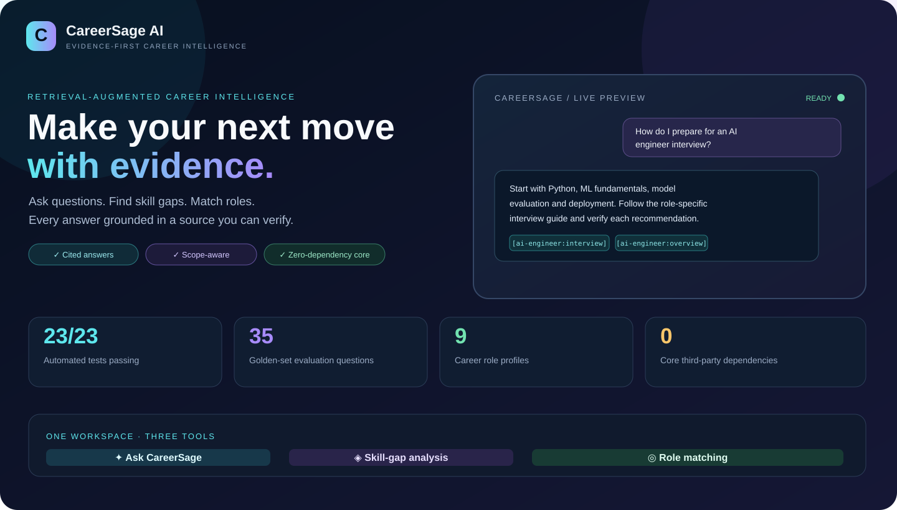
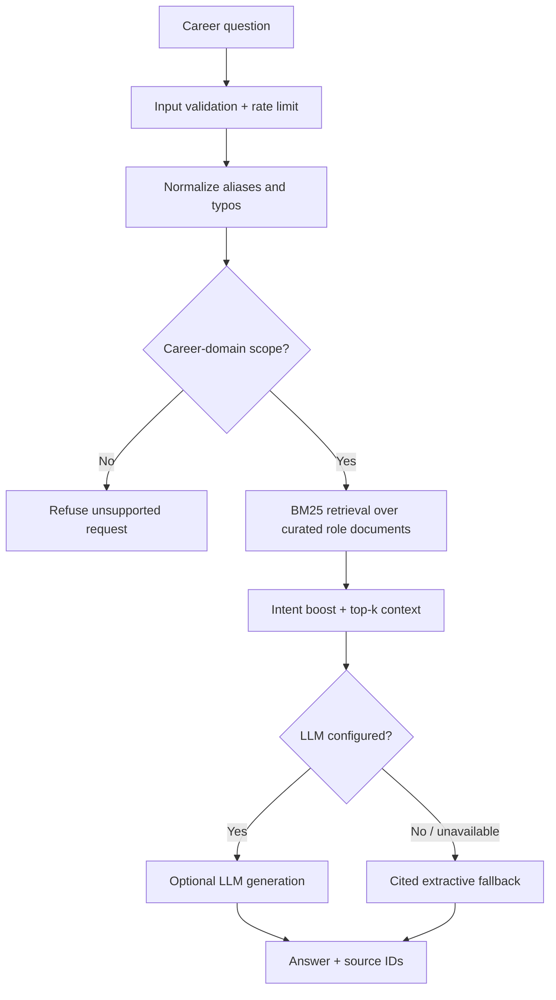

<div align="center">



<br>

[](https://github.com/AnyalstRushi/careersage-ai/actions/workflows/ci.yml)


**Evidence-first career intelligence. No confident guessing.**

[⚡ Quick start](#-quick-start) · [💬 Product preview](#-product-preview) · [🧠 How it works](#-how-it-works) · [🔌 API](#-api-reference) · [📚 Docs](#-documentation) · [🤝 Contribute](CONTRIBUTING.md)

</div>

---

## What is CareerSage AI?

CareerSage AI is an open-source, retrieval-augmented career assistant. It answers role and skill questions from a curated knowledge base, attaches source IDs to answers, refuses unrelated or unsupported questions, compares resume skills with target roles, and recommends role profiles based on skill overlap.

**The design principle is simple: retrieve first, answer second, cite the evidence.**

## Product preview

<div align="center">



**One workspace · Three workflows**

</div>

| Workflow | What it does |
|---|---|
| **Ask CareerSage** | Career Q&A with retrieved context, source references and an out-of-scope refusal path |
| **Skill-gap analysis** | Compares resume text with a selected role and returns matched skills, missing skills and a learning roadmap |
| **Role matching** | Ranks supported role profiles by overlap with skills found in resume text |

## Verified project snapshot

<div align="center">

| 23 / 23 | 35 | 9 | 0 |
|:---:|:---:|:---:|:---:|
| Automated tests passing | Golden-set evaluation questions | Career role profiles | Core third-party dependencies |

</div>

The repository's current automated test suite contains 23 tests. The evaluation runner uses a 35-question golden set and enforces its configured retrieval, refusal and citation thresholds. Reproduce the checks locally:

```bash
python -m unittest discover -v
python eval/run_eval.py
```

These are repository-level test and evaluation counts, not a claim of production accuracy or hiring outcomes.

## Why it is different

| Common chatbot failure | CareerSage approach |
|---|---|
| Answers beyond its knowledge | Career-domain scope guard and explicit refusal |
| Unsupported career advice | Curated role knowledge base and retrieved context |
| Citations that cannot be checked | Stable source IDs such as `[ai-engineer:roadmap]` |
| One-size-fits-all career suggestions | Resume-to-role skill overlap and missing-skill analysis |
| Requires a paid model to start | Standard-library extractive mode works without an API key |

## ⚡ Quick start

**Requirements:** Python 3.11 or newer. No package installation is required for the core application.

```bash
git clone https://github.com/AnyalstRushi/careersage-ai.git
cd careersage-ai
python -m app.server
```

Open **http://localhost:8000** in your browser.

The default core uses Python's standard library. Optional LLM generation can be enabled with a provider key; without it, CareerSage uses its cited extractive fallback.

<details>
<summary><strong>Optional: enable LLM generation</strong></summary>

Create a local `.env` file (never commit it) and configure the provider supported by the current `app/llm.py` implementation. For Gemini, the repository currently documents:

```env
GEMINI_API_KEY=your_gemini_api_key
LLM_MODEL=gemini-2.5-flash
RATE_LIMIT=60
PORT=8000
```

Restart the server and check `GET /health`. Keep all credentials in environment variables or a secret manager.

</details>

## 🧠 How it works



The same API also exposes deterministic resume skill-gap analysis and role matching. See the [architecture notes](docs/ARCHITECTURE.md) for the request flow and design decisions.

## ✨ Capabilities

- **Grounded career Q&A** — BM25 retrieval across curated role knowledge.
- **Source references** — answer payloads include source IDs that map to role documents.
- **Scope guard** — unrelated or unsupported questions are refused instead of guessed.
- **Intent-aware retrieval** — roadmap, interview and overview intent influence ranking.
- **Alias and typo tolerance** — common skill aliases and approximate typo correction.
- **Resume skill-gap analysis** — matched skills, missing skills, role score and roadmap.
- **Role recommendations** — ranks supported roles by skill overlap.
- **Optional LLM mode** — provider-backed generation with an extractive fallback.
- **Operational safeguards** — request-size limit, input validation, per-IP rate limiting, health endpoint and non-root Docker setup.

## 🔌 API reference

| Method | Endpoint | Purpose |
|:---:|---|---|
| `GET` | `/` | Responsive web application |
| `GET` | `/health` | Service status, document count and LLM status |
| `GET` | `/api/roles` | Supported roles and skill lists |
| `POST` | `/api/ask` | Grounded career question and citations |
| `POST` | `/api/gap` | Resume-to-role skill-gap analysis |
| `POST` | `/api/recommend` | Role recommendations from resume text |

<details>
<summary><strong>Example API requests</strong></summary>

**Ask a question**

```bash
curl -X POST http://localhost:8000/api/ask \
  -H "Content-Type: application/json" \
  -d '{"question":"What skills are required for a data analyst role?"}'
```

**Analyze a skill gap**

```bash
curl -X POST http://localhost:8000/api/gap \
  -H "Content-Type: application/json" \
  -d '{"resume":"Python SQL Excel Power BI dashboards","role":"data-analyst"}'
```

**Recommend roles**

```bash
curl -X POST http://localhost:8000/api/recommend \
  -H "Content-Type: application/json" \
  -d '{"resume":"Python SQL Azure ETL data pipelines"}'
```

</details>

## 🐳 Run with Docker

```bash
docker build -t careersage-ai .
docker run --rm -p 8000:8000 careersage-ai
```

For optional provider-backed generation, pass secrets through environment variables at runtime. Do not bake credentials into the image.

## 🔐 Security and privacy notes

- Do not paste real personal contact details or sensitive resume information unless you control and trust the server receiving the request.
- API keys belong in environment variables or a secret manager; never commit `.env`.
- The API applies request-size limits, input validation and per-IP rate limiting.
- The included in-memory rate limiter is suitable for a single process; multi-instance deployments need a shared rate-limit store.
- Use HTTPS and review deployment settings before exposing an instance publicly.

Report vulnerabilities privately using GitHub's **Report a vulnerability** feature where available. Read [SECURITY.md](SECURITY.md).

## 📚 Documentation and project files

| Resource | Description |
|---|---|
| [Project overview](docs/PROJECT_OVERVIEW.md) | Problem, scope, capabilities and project context |
| [Architecture](docs/ARCHITECTURE.md) | Components, request flow and design principles |
| [Contributing](CONTRIBUTING.md) | Fork, branch, test and pull-request workflow |
| [Security policy](SECURITY.md) | Vulnerability reporting and deployment guidance |
| [Code of conduct](CODE_OF_CONDUCT.md) | Community expectations |
| [PowerPoint deck](presentations/CareerSage_AI_Final.pptx) | Editable project presentation |
| [PDF deck](presentations/CareerSage_AI_Final.pdf) | Browser-friendly project presentation |

## 🗺️ Roadmap

- [ ] Hybrid BM25 + dense-vector retrieval
- [ ] Optional Qdrant or pgvector integration
- [ ] Cross-encoder reranking and retrieval evaluation
- [ ] Marathi and Hindi query support
- [ ] Resume PDF parsing with explicit user consent
- [ ] Expanded faithfulness and regression checks in CI

Roadmap items are planned work, not current capabilities. Contributions and focused issue reports are welcome.

## 🤝 Contributing

Bug reports, documentation improvements, tests and feature proposals are welcome. Start with [CONTRIBUTING.md](CONTRIBUTING.md), run the test suite and evaluation locally, and open a pull request with a clear description of the change.

---

<div align="center">

**Built by [@AnyalstRushi](https://github.com/AnyalstRushi)** · MIT License

If this project is useful, consider giving it a ⭐ and sharing thoughtful feedback.

</div>
